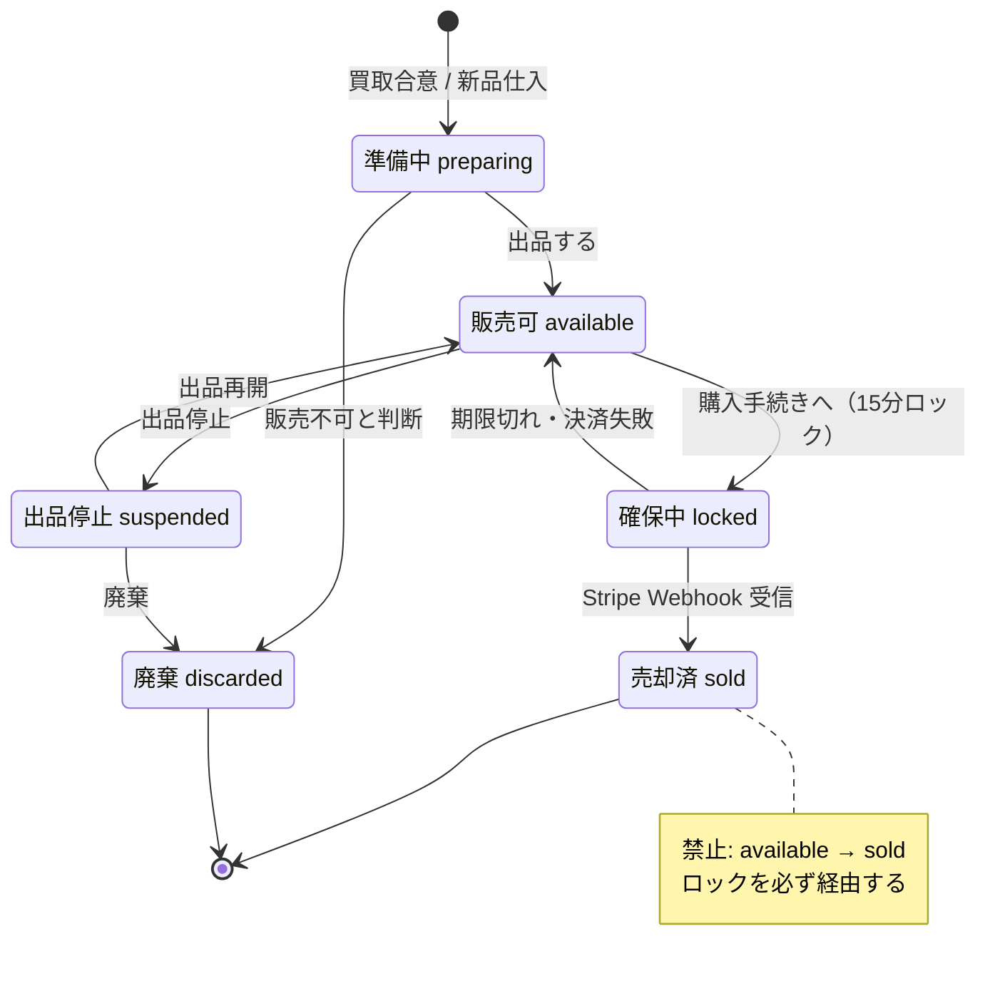
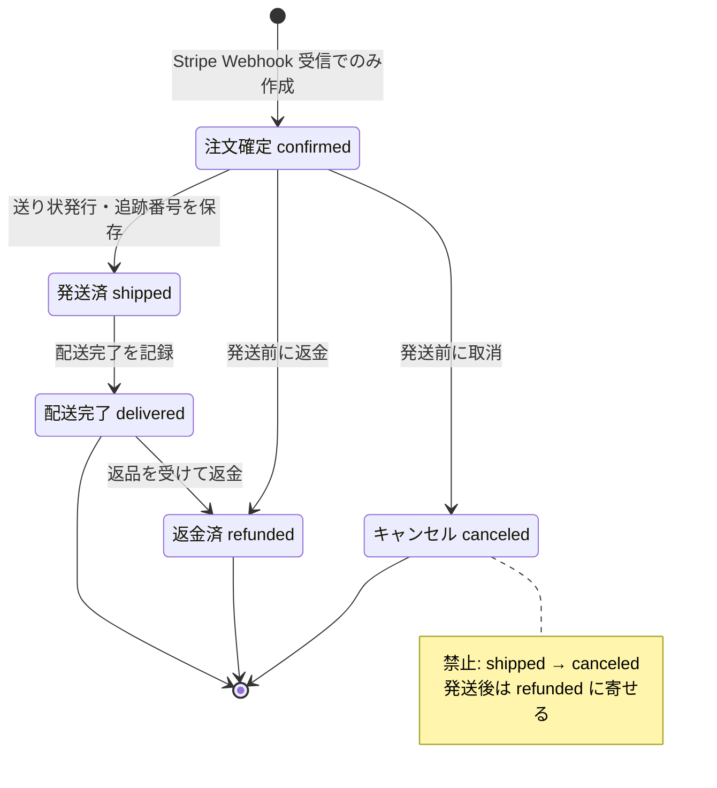
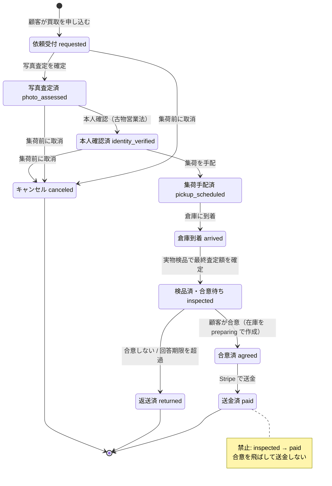

# EC MVP 状態遷移表

作成日: 2026-09-20 / 対象: 在庫・販売注文・買取注文

## 0. このドキュメントについて

- **正はこのリポジトリ**。Drive のスプレッドシートは人が読み返すためのスナップショット。
- 用語は [用語集](01-ubiquitous-language.md) に従う。
- ここに **許可** と書かれていない遷移は、すべて実装してはいけない。よく間違える遷移だけは **禁止** 行として明示した。

## 1. 前提

| 論点 | 決めたこと | 理由 |
| --- | --- | --- |
| 在庫を作るタイミング | 買取注文が `agreed`（合意済）になった時点、または新品を仕入れた時点 | 合意で所有権が移るため。送金完了まで待つと、合意済みで送金前の個体が帳簿から消える |
| 「検品中」の置き場所 | 買取注文のステータス（`arrived` → `inspected`）。在庫のステータスにはしない | 検品が終わって合意が成立するまで、その個体はまだ自社のものではない |
| 販売注文の起点 | Stripe の Webhook を受信して初めてレコードを作る（初期状態が `confirmed`） | 確定前の仮注文はチェックアウトセッションが担う。二重の「未確定注文」を持たない |
| 発送後の取り消し | `refunded`（返金済）に寄せる。`shipped → canceled` は禁止 | 荷物が動いた後と動く前では、やることも会計上の扱いも違う |
| 売却済からの復帰 | しない。返品で現物が戻ったら、新しい在庫行を `preparing` で作る | 「1 点ものが二重に売れない」を、状態ではなく行の存在で保証する |

## 2. ステータス一覧

| 対象 | ステータス | コード値 | 説明 | 初期 | 終端 | 守る不変条件 |
| --- | --- | --- | --- | --- | --- | --- |
| 在庫 | 準備中 | `preparing` | 自社所有になったが、まだ出品していない。清掃・採寸・撮影をする段階 | ○ | — | — |
| 在庫 | 販売可 | `available` | 販売枠に紐づいて出品済み。顧客が購入手続きに進める | — | — | 在庫ステータスが不正に遷移しない |
| 在庫 | 確保中 | `locked` | ソフトロックがかかっている。他の顧客は購入手続きに進めない | — | — | 1 点ものが二重に売れない |
| 在庫 | 売却済 | `sold` | 注文が確定した。二度と在庫には戻らない | — | ○ | 1 点ものが二重に売れない |
| 在庫 | 出品停止 | `suspended` | 運営判断で販売対象から外した。在庫としては残っている | — | — | — |
| 在庫 | 廃棄 | `discarded` | 販売できないと判断して処分した | — | ○ | — |
| 販売注文 | 注文確定 | `confirmed` | Stripe の入金確認が取れた状態。注文はここから始まる | ○ | — | 在庫ステータスが不正に遷移しない |
| 販売注文 | 発送済 | `shipped` | 送り状を発行し、配送業者に荷物を引き渡した | — | — | — |
| 販売注文 | 配送完了 | `delivered` | 顧客に届いた | — | ○ | — |
| 販売注文 | キャンセル | `canceled` | 発送前に取り消した。代金は返金する | — | ○ | — |
| 販売注文 | 返金済 | `refunded` | 発送後の返品などで代金を返した | — | ○ | — |
| 買取注文 | 依頼受付 | `requested` | 顧客が写真と自己申告ランクを添えて買取を申し込んだ | ○ | — | — |
| 買取注文 | 写真査定済 | `photo_assessed` | 写真だけを見た暫定査定額を顧客に提示した | — | — | — |
| 買取注文 | 本人確認済 | `identity_verified` | 身分証と申込内容の氏名・住所が一致することを確認した | — | — | 他人の個人データに到達できない |
| 買取注文 | 集荷手配済 | `pickup_scheduled` | 集荷日と時間帯が決まり、引き取りを待っている | — | — | — |
| 買取注文 | 倉庫到着 | `arrived` | 現物が倉庫に届いた。まだ中身は見ていない | — | — | — |
| 買取注文 | 検品済・合意待ち | `inspected` | 実物検品を終えて最終査定額を提示し、顧客の回答を待っている | — | — | — |
| 買取注文 | 合意済 | `agreed` | 顧客が最終査定額を承諾した。この時点で所有権が移る | — | — | — |
| 買取注文 | 送金済 | `paid` | Stripe 経由で買取金を顧客の口座へ送った | — | ○ | — |
| 買取注文 | 返送済 | `returned` | 顧客が合意せず、現物を返した | — | ○ | — |
| 買取注文 | キャンセル | `canceled` | 集荷前に取り消された | — | ○ | — |

## 3. 状態遷移図

許可される遷移だけを描いた。禁止遷移は 4 章の表を見る。Drive には同じ内容を SVG 画像でも置いてある（0 章のリンク）。

### 3.1 在庫

売却済から出る矢印が 1 本もないことが、「1 点ものが二重に売れない」の見た目上の保証になっている。

### 3.2 販売注文

注文確定より前の状態がない。入金が取れていない注文をそもそも作らせないため。

### 3.3 買取注文

合意済を必ず通ることが、顧客の承諾なしに送金しないという保証になっている。

## 4. 遷移表

「実行者」は、その遷移の引き金を引く人。システムとあるものは、人の操作を待たずに起きる。

### 4.1 在庫

| 遷移元 | 遷移先 | トリガー | 許可/禁止 | 実行者 | 条件・副作用 | 備考 |
| --- | --- | --- | --- | --- | --- | --- |
| （新規） | `preparing` | 買取注文が `agreed` になった | 許可 | システム | 買取注文 1 件につき在庫 1 行を作る。`cost_price` に最終査定額を入れる | 所有権が移った時点で在庫にする |
| （新規） | `preparing` | 新品の仕入れを登録した | 許可 | 管理者 | `cost_price` に仕入価格を入れる | — |
| `preparing` | `available` | 「出品する」操作（販売枠に紐づける） | 許可 | 管理者 | 販売枠が `published` であること | — |
| `available` | `locked` | 「購入手続きに進む」押下（チェックアウトセッション作成） | 許可 | 顧客 | `SELECT ... FOR UPDATE SKIP LOCKED` で空いた個体を 1 行掴み、`lock_checkout_session_id` と `lock_expires_at`（15 分後）を埋める | 先に掴んだ 1 人だけが成功。2 人目には 409 を返す |
| `locked` | `available` | ロック期限切れ | 許可 | システム | `lock_expires_at <= now()` なら失効。lock の 2 列を NULL に戻し、`inventory_movements` に `lock_expired` を残す | 画面はタイムアウトモーダルを出す |
| `locked` | `available` | 決済失敗 / 購入手続きの中断 | 許可 | 顧客・システム | ロックを明示的に失効させる | 期限切れを待たずに他の顧客が買えるようにする |
| `locked` | `sold` | Stripe Webhook `payment_intent.succeeded` を受信 | 許可 | システム | 同一トランザクション内で 販売注文の作成 → 在庫を `sold` → ロック解放 をまとめて行う | 注文確定はここが正 |
| `available` | `suspended` | 出品を停止した | 許可 | 管理者 | 販売枠からは外すが在庫行は残す | — |
| `suspended` | `available` | 出品を再開した | 許可 | 管理者 | 販売枠が `published` であること | — |
| `preparing` | `discarded` | 販売できないと判断した | 許可 | 管理者 | 理由を在庫変動履歴に残す | — |
| `suspended` | `discarded` | 廃棄した | 許可 | 管理者 | 理由を在庫変動履歴に残す | — |
| `available` | `sold` | — | **禁止** | — | ロックを経ずに売却済にはできない | 「1 点ものが二重に売れない」を守る要 |
| `locked` | `locked` | 別の顧客のチェックアウト | **禁止** | — | 有効なロックがある在庫は再ロックできない | 409 を返す。期限切れ後は `available` を経由する |
| `sold` | `available` | — | **禁止** | — | 売却済は在庫に戻らない | 返品で現物が戻ったら新しい在庫行を `preparing` で作る |
| `sold` | `locked` | — | **禁止** | — | 同上 | — |
| `preparing` | `locked` | — | **禁止** | — | 出品前の在庫は購入手続きに進めない | — |
| `suspended` | `locked` | — | **禁止** | — | 出品停止中の在庫は購入手続きに進めない | — |

### 4.2 販売注文

| 遷移元 | 遷移先 | トリガー | 許可/禁止 | 実行者 | 条件・副作用 | 備考 |
| --- | --- | --- | --- | --- | --- | --- |
| （新規） | `confirmed` | Stripe Webhook `payment_intent.succeeded` を受信 | 許可 | システム | トランザクション内で 在庫を `SELECT ... FOR UPDATE` → 注文と明細を作成 → 在庫を `sold` → ロック解放 | イベント ID で冪等化する |
| `confirmed` | `shipped` | 送り状を発行し「発送済みにする」 | 許可 | 管理者 | 配送業者と追跡番号を保存する | MVP は追跡番号を手入力 |
| `shipped` | `delivered` | 配送完了を記録した | 許可 | 管理者 | — | 配送キャリア API 連携は MVP 対象外 |
| `confirmed` | `canceled` | 発送前に取り消した | 許可 | 管理者 | Stripe で返金する。在庫は `sold` のまま | 同じ個体を再び売るときは新しい在庫行を作る |
| `confirmed` | `refunded` | 発送前に返金だけ行った | 許可 | 管理者 | Stripe で返金する | — |
| `delivered` | `refunded` | 返品を受け付けて返金した | 許可 | 管理者 | 現物が戻ったら新しい在庫行を `preparing` で作る | — |
| （新規） | `confirmed` | 管理画面からの手動作成 | **禁止** | — | 注文は Webhook 受信でのみ作る | 入金していない注文を作らせない |
| `confirmed` | `confirmed` | 同一 Webhook イベントの再送 | **禁止** | — | イベント ID で重複を弾き、既存の注文をそのまま返す | Stripe は同じイベントを複数回送ってくる |
| `shipped` | `confirmed` | — | **禁止** | — | 巻き戻しはできない | 誤操作は返金で処理する |
| `delivered` | `shipped` | — | **禁止** | — | 同上 | — |
| `shipped` | `canceled` | — | **禁止** | — | 発送後は `refunded` に寄せる | 荷物が動いた後は扱いが違う |
| `canceled` | （すべて） | — | **禁止** | — | 終端。ここから動かない | — |

### 4.3 買取注文

| 遷移元 | 遷移先 | トリガー | 許可/禁止 | 実行者 | 条件・副作用 | 備考 |
| --- | --- | --- | --- | --- | --- | --- |
| （新規） | `requested` | 顧客が買取を申し込んだ | 許可 | 顧客 | 写真と自己申告ランク、申告メモを登録する | MVP は 1 依頼 1 点 |
| `requested` | `photo_assessed` | 写真査定を確定した | 許可 | 管理者 | `estimated_amount` を保存し、顧客に提示する | 確定した約束ではない旨を画面に出す |
| `photo_assessed` | `identity_verified` | 本人確認が完了した | 許可 | 管理者 | 氏名・住所の一致を記録する | 古物営業法上の必須工程 |
| `identity_verified` | `pickup_scheduled` | 集荷を手配した | 許可 | 顧客・管理者 | 集荷希望日と時間帯を保存する | 時間帯指定は集荷料に反映 |
| `pickup_scheduled` | `arrived` | 現物が倉庫に届いた | 許可 | 管理者 | 到着日時を記録する | — |
| `arrived` | `inspected` | 実物検品を確定した | 許可 | 管理者 | 減額を積み上げて `final_assessed_amount` を確定し、回答期限を設定する | 減額は写真 1 枚ごとに理由と金額を残す |
| `inspected` | `agreed` | 顧客が査定金額に合意した | 許可 | 顧客 | 振込先口座が登録済みであること。**在庫行を `preparing` で作る** | ここで所有権が移る |
| `agreed` | `paid` | Stripe で送金した | 許可 | 管理者 | `final_assessed_amount − pickup_fee` を送金する | 送金額の内訳を明細に残す |
| `inspected` | `returned` | 顧客が返品を依頼した | 許可 | 顧客 | 返送料・集荷費用は請求しない | 操作は取り消せない旨を確認モーダルで出す |
| `inspected` | `returned` | 回答期限を超過した | 許可 | システム | 自動で返送を手配する | 期限はバナーで事前に知らせる |
| `requested` | `canceled` | 申込を取り消した | 許可 | 顧客 | 費用は発生しない | — |
| `photo_assessed` | `canceled` | 暫定査定額に納得せず取り消した | 許可 | 顧客 | 集荷前なので費用は発生しない | — |
| `identity_verified` | `canceled` | 集荷前に取り消した | 許可 | 顧客 | 費用は発生しない | — |
| `inspected` | `paid` | — | **禁止** | — | 顧客の合意なしに送金しない | 必ず `agreed` を経由する |
| `requested` | `paid` | — | **禁止** | — | 同上 | — |
| `requested` | `pickup_scheduled` | — | **禁止** | — | 写真査定と本人確認を飛ばせない | — |
| `photo_assessed` | `pickup_scheduled` | — | **禁止** | — | 本人確認前に現物を引き取れない | 古物営業法 |
| `agreed` | `returned` | — | **禁止** | — | 合意後の返送はできない | 合意の時点で所有権が移っているため |
| `arrived` | `canceled` | — | **禁止** | — | 現物を預かった後はキャンセルにしない | `inspected` → `returned` で返す |
| `paid` | （すべて） | — | **禁止** | — | 終端。ここから動かない | — |
