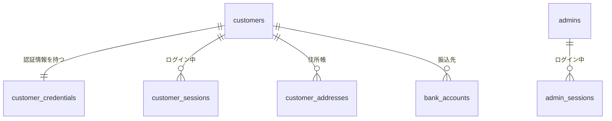
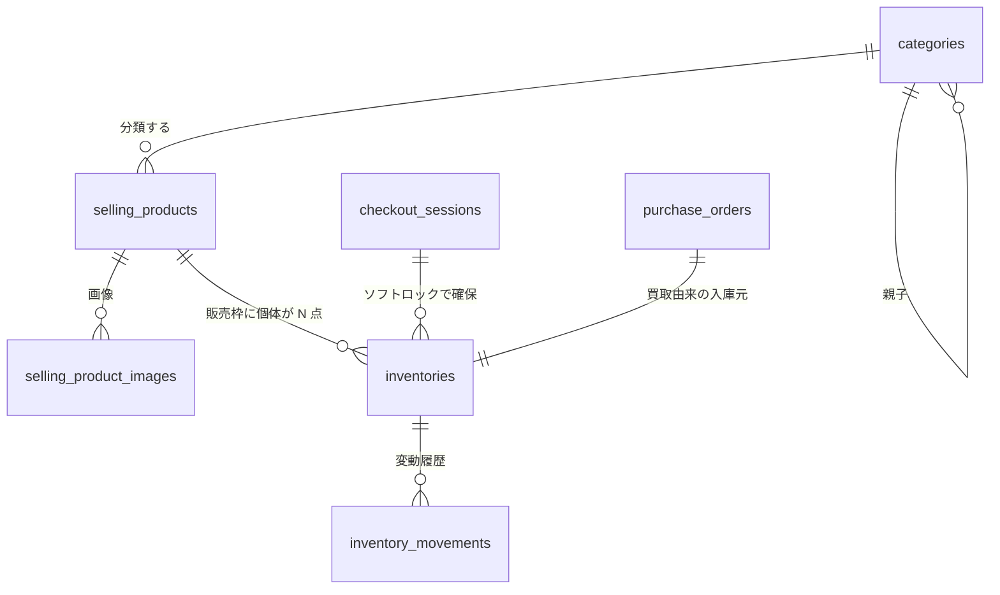
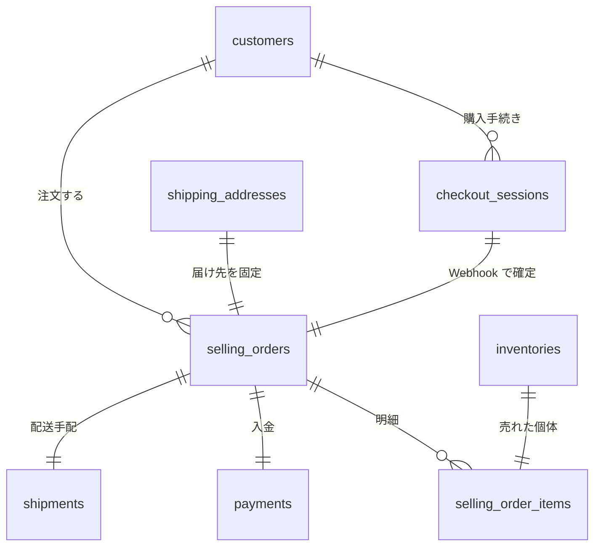
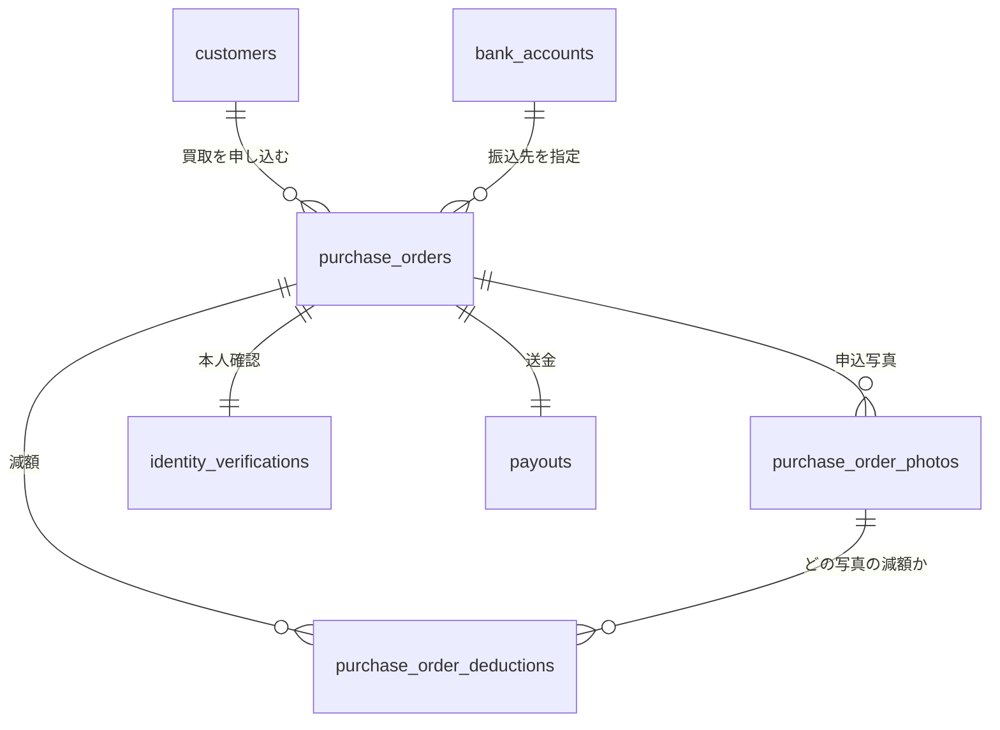

# EC MVP 論理データモデル

作成日: 2026-10-09 / 対象: PostgreSQL 18（golang-migrate + sqlc）

## 0. このドキュメントについて

- **正はこのリポジトリ**。Drive のスプレッドシートは人が読み返すためのスナップショット。
- 用語は [用語集](01-ubiquitous-language.md)、ステータスの値と遷移は [状態遷移表](02-state-transitions.md) を正とする。
- 既存資料（Drive のデータ設計）とは型も列名も変えてある。理由は用語集の「使ってはいけない別名」に書いた。

## 1. 全テーブル共通の方針

以下はすべてのテーブルに当てはまるので、4 章の各行からは省略した。

| 項目 | 決めたこと |
| --- | --- |
| 主キー | `id bigint GENERATED ALWAYS AS IDENTITY PRIMARY KEY`。文字列の主キーは使わない |
| 監査列 | `created_at` / `updated_at` を `timestamptz NOT NULL DEFAULT now()`。`updated_at` は `set_updated_at()` トリガーで更新（`.claude/rules/database.md`） |
| 金額 | `bigint`。円単位の整数。小数・浮動小数点は使わない |
| 日時 | `timestamptz`。列名は `_at` で終える。日付だけなら `date` で `_date` |
| 文字列 | `text`。`VARCHAR(n)` は使わない（長さ制限はアプリとドメインで表現する） |
| ステータス | `text` ＋ `CHECK (... IN (...))`。Postgres の enum 型は使わない（値の追加をマイグレーションで安全に行うため） |
| 外部キー | 原則 `ON DELETE RESTRICT`。取引の記録は消さない |
| 顧客に見せる ID | `selling_orders` と `purchase_orders` だけ `public_id uuid` を持ち、URL はこれを使う。内部の結合は `id` |
| 人が読む番号 | `order_number text`。専用シーケンスで `ORD-2026-000042` / `BUY-2026-000017`。年でリセットしない |

### 置いた前提

- 認証は MVP では自前実装。将来 Cognito などの OIDC に切り替えるため、`customer_credentials` に `auth_issuer` / `auth_subject` を先に用意しておく。切り替え時は `password_hash` を使わなくなるだけで、`customers` 以降のテーブルは変わらない。
- アカウント作成はメールアドレスとパスワードだけで行う。`customers` の氏名・フリガナ・電話番号は NULL 可とし、プロフィール編集（`PATCH /me`）で後から登録する。購入や買取を申し込む前に揃っていることは、DB ではなく各ユースケースで確かめる。OIDC に切り替えたときも、初回ログインで受け取れるのはメールアドレスと `sub` だけなので、同じ形で顧客を作れる。
- 決済手段はカードのみ（Stripe）。`payments` に決済手段の列を持たない。
- カートはサーバに持たない。ブラウザの `localStorage` に販売枠 ID を置くだけで、在庫は確保しない。

## 2. テーブル一覧（24）

| 区分 | テーブル | 日本語名 | 役割 | 主な関連 |
| --- | --- | --- | --- | --- |
| 認証 | `customers` | 顧客 | 買う人と売る人を兼ねるアカウント | 1:1 `customer_credentials` |
| 認証 | `customer_credentials` | 顧客の認証情報 | パスワードと、将来の OIDC の identity | 1:1 `customers` |
| 認証 | `customer_sessions` | 顧客セッション | ログイン中の Cookie を照合する | N:1 `customers` |
| 認証 | `admins` | 管理者 | 運営側の操作者。顧客とはテーブルを分ける | 1:N `admin_sessions` |
| 認証 | `admin_sessions` | 管理者セッション | 管理画面のログイン状態 | N:1 `admins` |
| カタログ | `categories` | カテゴリ | 家具・家電・周辺機器などの分類 | 自己参照の親子 |
| カタログ | `selling_products` | 販売枠 | 同じ型番・同じランクをまとめて売り出す単位 | 1:N `inventories` |
| カタログ | `selling_product_images` | 商品画像 | 販売枠に紐づく画像。枚数可変 | N:1 `selling_products` |
| 在庫 | `inventories` | 在庫 | 実在する個体 1 点。ソフトロックの列もここに持つ | N:1 `selling_products` |
| 在庫 | `inventory_movements` | 在庫変動履歴 | 入庫・出品・ロック・販売の時系列ログ | N:1 `inventories` |
| 住所 | `customer_addresses` | 顧客の登録住所 | 顧客が使い回す住所帳 | N:1 `customers` |
| 住所 | `shipping_addresses` | 配送先住所 | 注文ごとに確定して固定する届け先 | 1:1 `selling_orders` |
| 販売 | `checkout_sessions` | チェックアウトセッション | 購入手続き 1 回。在庫ロックと決済を束ねる | 1:1 `selling_orders` |
| 販売 | `selling_orders` | 販売注文 | 確定した販売取引 1 件 | 1:N `selling_order_items` |
| 販売 | `selling_order_items` | 注文明細 | 売れた個体 1 点ぶんの記録 | N:1 `selling_orders` |
| 販売 | `payments` | 決済 | 顧客から代金を受け取った記録 | 1:1 `selling_orders` |
| 販売 | `stripe_webhook_events` | 決済 Webhook イベント | Stripe からの通知。重複を弾く台帳 | 他テーブルとは FK で結ばない |
| 販売 | `shipments` | 配送 | 送り状と追跡番号の手配 | 1:1 `selling_orders` |
| 買取 | `purchase_orders` | 買取注文 | 申込から送金までの取引 1 件 | 1:1 `inventories` |
| 買取 | `purchase_order_photos` | 申込写真 | 顧客が送った写真と、管理者の評価 | N:1 `purchase_orders` |
| 買取 | `purchase_order_deductions` | 減額 | 実物検品での減額 1 件ぶん | N:1 `purchase_orders` |
| 買取 | `identity_verifications` | 本人確認 | 古物営業法のための確認記録 | 1:1 `purchase_orders` |
| 買取 | `bank_accounts` | 振込先口座 | 顧客が送金を受け取る口座 | N:1 `customers` |
| 買取 | `payouts` | 送金 | 買取金を顧客口座へ送った記録 | 1:1 `purchase_orders` |

## 3. ER 図

区分ごとに 4 枚に分けた。24 テーブルを 1 枚に描くと読めない。各テーブルは 1 枚にだけ登場する。

下の Mermaid は関連の全体像を見るためのもの。**カラムと型まで入った ER 図は SVG にある。**

| 区分 | カラム付き ER 図（SVG） |
| --- | --- |
| 認証・アクター | [diagrams/er-auth.svg](diagrams/er-auth.svg) |
| カタログと在庫 | [diagrams/er-catalog-inventory.svg](diagrams/er-catalog-inventory.svg) |
| 販売 | [diagrams/er-selling.svg](diagrams/er-selling.svg) |
| 買取 | [diagrams/er-purchase.svg](diagrams/er-purchase.svg) |

### 3.1 認証・アクター

### 3.2 カタログと在庫

### 3.3 販売

`stripe_webhook_events` はどのテーブルとも FK で結ばない。Stripe から届いた生の通知を順番に受け止める台帳で、ここに同じ `stripe_event_id` が入らないことだけを保証する。

### 3.4 買取

## 4. カラム定義

`id` / `created_at` / `updated_at` は 1 章のとおり全テーブルに付くので省略した。

### 4.1 認証・アクター

| テーブル | カラム | 型 | NULL | 制約 | 説明 | 関連 |
| --- | --- | --- | --- | --- | --- | --- |
| `customers` | `family_name` | text | 可 | — | 姓。アカウント作成時は NULL で、プロフィール編集で登録する | — |
| `customers` | `given_name` | text | 可 | — | 名 | — |
| `customers` | `family_name_kana` | text | 可 | — | 姓のフリガナ。振込先の名義照合に使う | — |
| `customers` | `given_name_kana` | text | 可 | — | 名のフリガナ | — |
| `customers` | `email` | text | 不可 | UNIQUE | 連絡先。MVP ではログイン ID も兼ねる | — |
| `customers` | `phone_number` | text | 可 | — | 配送時の連絡と本人確認に使う | — |
| `customer_credentials` | `customer_id` | bigint | 不可 | UNIQUE, FK → `customers.id` | どの顧客の認証情報か | 1:1 `customers` |
| `customer_credentials` | `password_hash` | text | 可 | — | 自前認証用。OIDC に切り替えたら使わなくなる | — |
| `customer_credentials` | `auth_issuer` | text | 可 | UNIQUE (`auth_issuer`, `auth_subject`) | OIDC の `iss`。MVP では NULL | — |
| `customer_credentials` | `auth_subject` | text | 可 | 同上 | OIDC の `sub`。MVP では NULL | — |
| `customer_sessions` | `customer_id` | bigint | 不可 | FK → `customers.id` | セッションの持ち主 | N:1 `customers` |
| `customer_sessions` | `token_hash` | text | 不可 | UNIQUE | Cookie の値のハッシュ。生の値は保存しない | — |
| `customer_sessions` | `expires_at` | timestamptz | 不可 | — | セッションの期限 | — |
| `customer_sessions` | `revoked_at` | timestamptz | 可 | — | ログアウトした時刻。行は消さない | — |
| `admins` | `email` | text | 不可 | UNIQUE | 管理者のログイン ID | — |
| `admins` | `password_hash` | text | 不可 | — | 管理者のパスワード | — |
| `admins` | `display_name` | text | 不可 | — | 操作ログに出す名前 | — |
| `admin_sessions` | `admin_id` | bigint | 不可 | FK → `admins.id` | セッションの持ち主 | N:1 `admins` |
| `admin_sessions` | `token_hash` | text | 不可 | UNIQUE | 顧客セッションとは別のテーブルに分ける | — |
| `admin_sessions` | `expires_at` | timestamptz | 不可 | — | セッションの期限 | — |
| `admin_sessions` | `revoked_at` | timestamptz | 可 | — | ログアウトした時刻 | — |

### 4.2 カタログ

| テーブル | カラム | 型 | NULL | 制約 | 説明 | 関連 |
| --- | --- | --- | --- | --- | --- | --- |
| `categories` | `name` | text | 不可 | — | 画面に出す名前 | — |
| `categories` | `slug` | text | 不可 | UNIQUE | URL に使う識別子 | — |
| `categories` | `parent_id` | bigint | 可 | FK → `categories.id` | 親カテゴリ。最上位は NULL | 自己参照 |
| `categories` | `display_order` | integer | 不可 | DEFAULT 0 | 並び順 | — |
| `selling_products` | `category_id` | bigint | 不可 | FK → `categories.id` | 所属カテゴリ | N:1 `categories` |
| `selling_products` | `name` | text | 不可 | — | 商品名 | — |
| `selling_products` | `model_number` | text | 不可 | — | 型番。販売枠と在庫をまとめる軸 | — |
| `selling_products` | `product_condition` | text | 不可 | CHECK: new、used | 新品か中古かの区分 | — |
| `selling_products` | `condition_rank` | text | 可 | CHECK: S、A、B_PLUS、B、C、D | 中古のコンディション。新品は NULL | — |
| `selling_products` | `selling_price` | bigint | 不可 | CHECK >= 0 | 税込の販売価格 | — |
| `selling_products` | `description` | text | 不可 | DEFAULT '' | 運営が書く説明文 | — |
| `selling_products` | `listing_status` | text | 不可 | CHECK: draft、published、suspended、DEFAULT 'draft' | 顧客に見せるかどうか | — |
| `selling_product_images` | `selling_product_id` | bigint | 不可 | FK → `selling_products.id` | どの販売枠の画像か | N:1 `selling_products` |
| `selling_product_images` | `image_url` | text | 不可 | — | 画像の保存先 URL | — |
| `selling_product_images` | `display_order` | integer | 不可 | UNIQUE (`selling_product_id`, `display_order`) | 表示順。1 枚目がメイン | — |
| `selling_product_images` | `alt_text` | text | 可 | — | 代替テキスト | — |

### 4.3 在庫

| テーブル | カラム | 型 | NULL | 制約 | 説明 | 関連 |
| --- | --- | --- | --- | --- | --- | --- |
| `inventories` | `selling_product_id` | bigint | 可 | FK → `selling_products.id` | 紐づく販売枠。準備中はまだ決まっていないので NULL | N:1 `selling_products` |
| `inventories` | `purchase_order_id` | bigint | 可 | UNIQUE, FK → `purchase_orders.id` | 買取由来の入庫元。新品仕入れは NULL。1 依頼 1 点なので UNIQUE | 1:1 `purchase_orders` |
| `inventories` | `inventory_status` | text | 不可 | CHECK: preparing、available、locked、sold、suspended、discarded、DEFAULT 'preparing' | 個体の状態。遷移は状態遷移表 4.1 が正 | — |
| `inventories` | `condition_rank` | text | 可 | CHECK: S、A、B_PLUS、B、C、D | 検品で確定した個体のランク。新品は NULL | — |
| `inventories` | `cost_price` | bigint | 不可 | CHECK >= 0 | 仕入原価。買取なら最終査定額、新品なら仕入価格 | — |
| `inventories` | `storage_location` | text | 可 | — | 倉庫の棚番号。ピッキングに使う | — |
| `inventories` | `lock_checkout_session_id` | bigint | 可 | FK → `checkout_sessions.id` | **在庫ソフトロックの持ち主**。在庫 1 行に 1 つなので二重の取り置きが表現できない | N:1 `checkout_sessions` |
| `inventories` | `lock_expires_at` | timestamptz | 可 | — | ソフトロックの失効時刻。取得時刻の 15 分後 | — |
| `inventories` | `sold_at` | timestamptz | 可 | — | 売却が確定した時刻 | — |
| `inventories` | `discard_reason` | text | 可 | — | 廃棄した理由 | — |
| `inventory_movements` | `inventory_id` | bigint | 不可 | FK → `inventories.id` | どの個体の変動か | N:1 `inventories` |
| `inventory_movements` | `movement_type` | text | 不可 | CHECK: receiving、listed、unlisted、locked、lock_expired、lock_released、sold、discarded | 変動の種類 | — |
| `inventory_movements` | `selling_order_id` | bigint | 可 | FK → `selling_orders.id` | 販売に伴う変動のときの出庫先 | N:1 `selling_orders` |
| `inventory_movements` | `purchase_order_id` | bigint | 可 | FK → `purchase_orders.id` | 入庫に伴う変動のときの入庫元 | N:1 `purchase_orders` |
| `inventory_movements` | `admin_id` | bigint | 可 | FK → `admins.id` | 人が操作した場合の実行者。システム起因は NULL | N:1 `admins` |
| `inventory_movements` | `note` | text | 可 | — | 棚卸し差異などの補足 | — |

### 4.4 住所

| テーブル | カラム | 型 | NULL | 制約 | 説明 | 関連 |
| --- | --- | --- | --- | --- | --- | --- |
| `customer_addresses` | `customer_id` | bigint | 不可 | FK → `customers.id` | 住所の持ち主 | N:1 `customers` |
| `customer_addresses` | `recipient_name` | text | 不可 | — | 宛名 | — |
| `customer_addresses` | `postal_code` | text | 不可 | — | 郵便番号。ハイフンなしで保存する | — |
| `customer_addresses` | `prefecture` | text | 不可 | — | 都道府県 | — |
| `customer_addresses` | `city` | text | 不可 | — | 市区町村 | — |
| `customer_addresses` | `street_address` | text | 不可 | — | 番地まで | — |
| `customer_addresses` | `building` | text | 可 | — | 建物名と部屋番号 | — |
| `customer_addresses` | `phone_number` | text | 不可 | — | 配送時の連絡先 | — |
| `customer_addresses` | `is_default` | boolean | 不可 | DEFAULT false | 既定の住所かどうか | — |
| `shipping_addresses` | `recipient_name` | text | 不可 | — | 注文時点の宛名。顧客が住所帳を直しても変わらない | — |
| `shipping_addresses` | `postal_code` | text | 不可 | — | 郵便番号 | — |
| `shipping_addresses` | `prefecture` | text | 不可 | — | 都道府県 | — |
| `shipping_addresses` | `city` | text | 不可 | — | 市区町村 | — |
| `shipping_addresses` | `street_address` | text | 不可 | — | 番地まで | — |
| `shipping_addresses` | `building` | text | 可 | — | 建物名と部屋番号 | — |
| `shipping_addresses` | `phone_number` | text | 不可 | — | 配送時の連絡先 | — |

### 4.5 販売

| テーブル | カラム | 型 | NULL | 制約 | 説明 | 関連 |
| --- | --- | --- | --- | --- | --- | --- |
| `checkout_sessions` | `customer_id` | bigint | 不可 | FK → `customers.id` | 購入手続きをしている顧客 | N:1 `customers` |
| `checkout_sessions` | `status` | text | 不可 | CHECK: active、completed、expired、canceled、DEFAULT 'active' | 手続きの進行状況 | — |
| `checkout_sessions` | `expires_at` | timestamptz | 不可 | — | 手続きの期限。確保した在庫の `lock_expires_at` と同じ値を入れる | — |
| `checkout_sessions` | `stripe_payment_intent_id` | text | 可 | UNIQUE | Stripe 側の支払いオブジェクト。決済に進んだ時点で入る | — |
| `checkout_sessions` | `completed_at` | timestamptz | 可 | — | 注文が確定した時刻 | — |
| `selling_orders` | `public_id` | uuid | 不可 | UNIQUE, DEFAULT `gen_random_uuid()` | 顧客向け URL に使う ID。連番を外に出さない | — |
| `selling_orders` | `order_number` | text | 不可 | UNIQUE | 人が読む番号。`ORD-2026-000042` | — |
| `selling_orders` | `customer_id` | bigint | 不可 | FK → `customers.id` | 購入者 | N:1 `customers` |
| `selling_orders` | `checkout_session_id` | bigint | 不可 | UNIQUE, FK → `checkout_sessions.id` | どの購入手続きから確定したか | 1:1 `checkout_sessions` |
| `selling_orders` | `shipping_address_id` | bigint | 不可 | UNIQUE, FK → `shipping_addresses.id` | 注文時点で固定した届け先 | 1:1 `shipping_addresses` |
| `selling_orders` | `selling_order_status` | text | 不可 | CHECK: confirmed、shipped、delivered、canceled、refunded、DEFAULT 'confirmed' | 注文の進行状況。遷移は状態遷移表 4.2 が正 | — |
| `selling_orders` | `subtotal` | bigint | 不可 | CHECK >= 0 | 商品代の小計 | — |
| `selling_orders` | `shipping_fee` | bigint | 不可 | CHECK >= 0 | 配送料 | — |
| `selling_orders` | `tax_amount` | bigint | 不可 | CHECK >= 0 | 消費税 | — |
| `selling_orders` | `total_amount` | bigint | 不可 | CHECK >= 0 | 合計。内訳も保存して後から計算し直さない | — |
| `selling_orders` | `canceled_at` | timestamptz | 可 | — | 取り消した時刻 | — |
| `selling_orders` | `cancel_reason` | text | 可 | — | 取り消した理由 | — |
| `selling_order_items` | `selling_order_id` | bigint | 不可 | FK → `selling_orders.id` | どの注文の明細か | N:1 `selling_orders` |
| `selling_order_items` | `inventory_id` | bigint | 不可 | UNIQUE, FK → `inventories.id` | **売れた個体**。UNIQUE なので同じ個体が 2 つの注文に現れない | 1:1 `inventories` |
| `selling_order_items` | `selling_product_id` | bigint | 不可 | FK → `selling_products.id` | 売れた販売枠 | N:1 `selling_products` |
| `selling_order_items` | `product_name` | text | 不可 | — | 注文時点の商品名。後から販売枠を直しても変わらない | — |
| `selling_order_items` | `unit_price` | bigint | 不可 | CHECK >= 0 | 注文時点の単価 | — |
| `payments` | `selling_order_id` | bigint | 不可 | UNIQUE, FK → `selling_orders.id` | どの注文の決済か | 1:1 `selling_orders` |
| `payments` | `stripe_payment_intent_id` | text | 不可 | UNIQUE | Stripe 側の支払いオブジェクト | — |
| `payments` | `amount` | bigint | 不可 | CHECK > 0 | 受け取った金額 | — |
| `payments` | `status` | text | 不可 | CHECK: succeeded、refunded | 決済の状態。MVP はカードのみなので待機状態がない | — |
| `payments` | `paid_at` | timestamptz | 不可 | — | 入金が確認できた時刻 | — |
| `payments` | `refunded_at` | timestamptz | 可 | — | 返金した時刻 | — |
| `stripe_webhook_events` | `stripe_event_id` | text | 不可 | UNIQUE | **冪等化の鍵**。同じイベントが再送されてもここで弾く | — |
| `stripe_webhook_events` | `event_type` | text | 不可 | — | `payment_intent.succeeded` などの種別 | — |
| `stripe_webhook_events` | `payload` | jsonb | 不可 | — | 届いた通知をそのまま保存する | — |
| `stripe_webhook_events` | `processed_at` | timestamptz | 可 | — | 処理が終わった時刻。NULL なら未処理 | — |
| `stripe_webhook_events` | `error_message` | text | 可 | — | 処理に失敗した理由 | — |
| `shipments` | `selling_order_id` | bigint | 不可 | UNIQUE, FK → `selling_orders.id` | どの注文の配送か | 1:1 `selling_orders` |
| `shipments` | `carrier_code` | text | 不可 | CHECK: yamato_kazai、yamato、sagawa、japan_post | 配送業者 | — |
| `shipments` | `tracking_number` | text | 可 | — | 追跡番号。MVP は管理者が手入力する | — |
| `shipments` | `requested_delivery_date` | date | 可 | — | 顧客が希望したお届け日 | — |
| `shipments` | `requested_time_slot` | text | 可 | — | 顧客が希望した時間帯 | — |
| `shipments` | `shipped_at` | timestamptz | 可 | — | 荷物を引き渡した時刻 | — |
| `shipments` | `delivered_at` | timestamptz | 可 | — | 配送が完了した時刻 | — |

### 4.6 買取

| テーブル | カラム | 型 | NULL | 制約 | 説明 | 関連 |
| --- | --- | --- | --- | --- | --- | --- |
| `purchase_orders` | `public_id` | uuid | 不可 | UNIQUE, DEFAULT `gen_random_uuid()` | 顧客向け URL に使う ID | — |
| `purchase_orders` | `order_number` | text | 不可 | UNIQUE | 人が読む番号。`BUY-2026-000017` | — |
| `purchase_orders` | `customer_id` | bigint | 不可 | FK → `customers.id` | 売却者 | N:1 `customers` |
| `purchase_orders` | `purchase_order_status` | text | 不可 | CHECK: requested、photo_assessed、identity_verified、pickup_scheduled、arrived、inspected、agreed、paid、returned、canceled、DEFAULT 'requested' | 買取の進行状況。遷移は状態遷移表 4.3 が正 | — |
| `purchase_orders` | `declared_model_number` | text | 不可 | — | 顧客が申告した型番 | — |
| `purchase_orders` | `declared_rank` | text | 可 | CHECK: S、A、B_PLUS、B、C、D | 顧客の自己申告ランク。査定結果とは別物 | — |
| `purchase_orders` | `declared_note` | text | 可 | — | 顧客が書いた状態の説明 | — |
| `purchase_orders` | `estimated_amount` | bigint | 可 | CHECK >= 0 | 暫定査定額。写真査定で入る。確定した約束ではない | — |
| `purchase_orders` | `final_assessed_amount` | bigint | 可 | CHECK >= 0 | 最終査定額。実物検品で入る。集荷料を引く前の額 | — |
| `purchase_orders` | `pickup_fee` | bigint | 不可 | CHECK >= 0, DEFAULT 0 | 集荷料。最終査定額から差し引いて送金する | — |
| `purchase_orders` | `bank_account_id` | bigint | 可 | FK → `bank_accounts.id` | 顧客が指定した振込先。合意時に必須 | N:1 `bank_accounts` |
| `purchase_orders` | `pickup_scheduled_date` | date | 可 | — | 集荷希望日 | — |
| `purchase_orders` | `pickup_time_slot` | text | 可 | — | 集荷の時間帯。指定すると集荷料が上がる | — |
| `purchase_orders` | `arrived_at` | timestamptz | 可 | — | 現物が倉庫に届いた時刻 | — |
| `purchase_orders` | `inspected_at` | timestamptz | 可 | — | 実物検品が終わった時刻 | — |
| `purchase_orders` | `agreement_deadline_at` | timestamptz | 可 | — | 顧客の回答期限。超過すると自動で返送する | — |
| `purchase_orders` | `agreed_at` | timestamptz | 可 | — | 顧客が合意した時刻。ここで所有権が移る | — |
| `purchase_orders` | `returned_at` | timestamptz | 可 | — | 返送した時刻 | — |
| `purchase_orders` | `canceled_at` | timestamptz | 可 | — | 集荷前に取り消した時刻 | — |
| `purchase_order_photos` | `purchase_order_id` | bigint | 不可 | FK → `purchase_orders.id` | どの買取依頼の写真か | N:1 `purchase_orders` |
| `purchase_order_photos` | `image_url` | text | 不可 | — | 画像の保存先 URL | — |
| `purchase_order_photos` | `label` | text | 不可 | — | 「全体外観（前面）」などの部位ラベル | — |
| `purchase_order_photos` | `customer_note` | text | 可 | — | 顧客が書いたこの写真の状態説明 | — |
| `purchase_order_photos` | `display_order` | integer | 不可 | UNIQUE (`purchase_order_id`, `display_order`) | 表示順 | — |
| `purchase_order_photos` | `admin_condition` | text | 可 | CHECK: good、scratched、malfunction | 管理者の評価。検品前は NULL | — |
| `purchase_order_deductions` | `purchase_order_id` | bigint | 不可 | FK → `purchase_orders.id` | どの買取依頼の減額か | N:1 `purchase_orders` |
| `purchase_order_deductions` | `purchase_order_photo_id` | bigint | 可 | FK → `purchase_order_photos.id` | 根拠となる写真。写真に紐づかない減額は NULL | N:1 `purchase_order_photos` |
| `purchase_order_deductions` | `reason` | text | 不可 | — | 減額の理由。顧客に提示する | — |
| `purchase_order_deductions` | `amount` | bigint | 不可 | CHECK > 0 | 差し引く金額 | — |
| `purchase_order_deductions` | `admin_id` | bigint | 不可 | FK → `admins.id` | 減額を決めた担当者 | N:1 `admins` |
| `identity_verifications` | `purchase_order_id` | bigint | 不可 | UNIQUE, FK → `purchase_orders.id` | どの買取依頼の本人確認か | 1:1 `purchase_orders` |
| `identity_verifications` | `document_image_url` | text | 不可 | — | 身分証の画像 | — |
| `identity_verifications` | `name_matched` | boolean | 不可 | DEFAULT false | 氏名が一致したか | — |
| `identity_verifications` | `address_matched` | boolean | 不可 | DEFAULT false | 住所が一致したか | — |
| `identity_verifications` | `verified_at` | timestamptz | 可 | — | 確認が完了した時刻 | — |
| `identity_verifications` | `admin_id` | bigint | 可 | FK → `admins.id` | 確認した担当者 | N:1 `admins` |
| `bank_accounts` | `customer_id` | bigint | 不可 | FK → `customers.id` | 口座の持ち主 | N:1 `customers` |
| `bank_accounts` | `bank_name` | text | 不可 | — | 金融機関名 | — |
| `bank_accounts` | `branch_name` | text | 不可 | — | 支店名 | — |
| `bank_accounts` | `account_type` | text | 不可 | CHECK: ordinary、checking | 普通か当座か | — |
| `bank_accounts` | `account_number` | text | 不可 | — | 口座番号 | — |
| `bank_accounts` | `account_holder_kana` | text | 不可 | — | 口座名義のカタカナ | — |
| `payouts` | `purchase_order_id` | bigint | 不可 | UNIQUE, FK → `purchase_orders.id` | どの買取依頼の送金か | 1:1 `purchase_orders` |
| `payouts` | `bank_account_id` | bigint | 不可 | FK → `bank_accounts.id` | 送金先の口座 | N:1 `bank_accounts` |
| `payouts` | `amount` | bigint | 不可 | CHECK > 0 | 送金額。最終査定額 − 集荷料 | — |
| `payouts` | `stripe_payout_id` | text | 可 | UNIQUE | Stripe 側の送金オブジェクト | — |
| `payouts` | `status` | text | 不可 | CHECK: pending、succeeded、failed、DEFAULT 'pending' | 送金の状態 | — |
| `payouts` | `paid_at` | timestamptz | 可 | — | 送金が完了した時刻 | — |

## 5. テーブル単位の制約

列を 1 つ見ても分からない制約をここに集めた。

| テーブル | 制約 | 狙い |
| --- | --- | --- |
| `selling_products` | `UNIQUE (model_number, product_condition, condition_rank)` | 同じ型番・区分・ランクの販売枠を 2 つ作らせない |
| `selling_products` | `CHECK ((product_condition = 'used') = (condition_rank IS NOT NULL))` | 中古にはランクが必ずあり、新品には必ずない |
| `inventories` | `CHECK ((lock_checkout_session_id IS NULL) = (lock_expires_at IS NULL))` | ロックの持ち主と期限が片方だけ入った状態を作らせない |
| `inventories` | `CHECK (inventory_status <> 'sold' OR sold_at IS NOT NULL)` | 売却済なら売却時刻がある |
| `inventories` | `CHECK (selling_product_id IS NOT NULL OR inventory_status IN ('preparing','discarded'))` | 販売枠に紐づかない個体は出品できない |
| `selling_orders` | `CHECK (total_amount = subtotal + shipping_fee + tax_amount)` | 内訳と合計が食い違わない |
| `purchase_orders` | `CHECK (purchase_order_status <> 'agreed' OR (final_assessed_amount IS NOT NULL AND bank_account_id IS NOT NULL))` | 合意するには最終査定額と振込先が揃っている |
| `purchase_orders` | `CHECK (final_assessed_amount IS NULL OR final_assessed_amount >= pickup_fee)` | 集荷料を引いて送金額が負にならない |
| `customer_addresses` | `UNIQUE (customer_id) WHERE is_default` | 既定の住所は顧客あたり 1 件だけ |
| `customers` | `CHECK (email = lower(email))` | 小文字にそろえた値だけを保存し、`email` の UNIQUE で大文字・小文字違いの重複も弾く |

## 6. 不変条件をどこで守っているか

**不変条件の正はこの章とする。**他のドキュメントにある記述は要約で、食い違ったらここが正しい。

| 不変条件 | 守っている仕組み |
| --- | --- |
| 1 点ものが二重に売れない | ① `inventories` の `lock_checkout_session_id` と `lock_expires_at` が在庫 1 行に 1 組しかない（二重の取り置きが表現できない）② 取得は `SELECT ... FOR UPDATE SKIP LOCKED` で 1 行だけ掴む ③ `selling_order_items.inventory_id` の UNIQUE が最後の砦 ④ `stripe_webhook_events.stripe_event_id` の UNIQUE で Webhook の二重適用を弾く |
| 在庫ステータスが不正に遷移しない | ① 各ステータス列の `CHECK` で値を限定 ② 許可された遷移だけをユースケース層に実装（状態遷移表 4 章） ③ 5 章の横断 `CHECK` で矛盾した組み合わせを禁止 |
| 他人の個人データ・税務データに URL を書き換えても到達できない | ① 顧客と管理者をテーブルから分離（`customers` / `admins`、セッションも別） ② 顧客向け URL は `public_id uuid` を使い連番を出さない ③ 顧客自身は URL に出さず `/me/...` でセッションから引く ④ 認可はミドルウェアで強制し、ハンドラごとの判断にしない |
